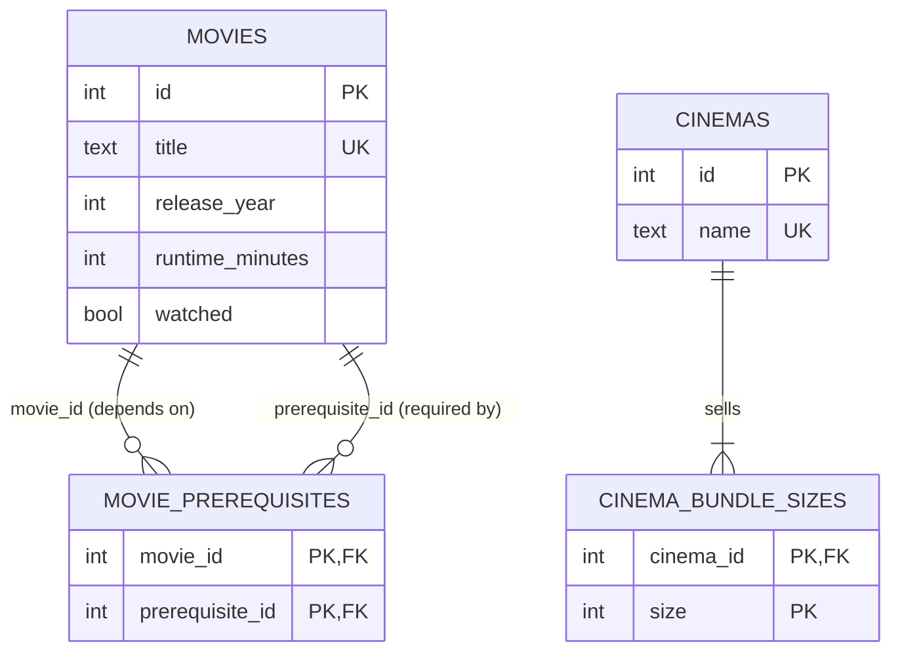

# Doomsday Ready: Build Plan

A phased specification for building **Doomsday Ready**, a small full-stack app that helps MCU fans plan a rewatch before *Avengers: Doomsday* and book an opening-night watch party.

Work proceeds phase by phase. Each phase has a goal, tasks, and an "exit check" that must pass before the next phase begins.

---

## 1. Product Summary

| Area | What it does |
| --- | --- |
| Movies and Rewatch Order | Stores movies with prerequisites, rejects circular dependencies, and returns an ordered list of everything to watch before a target movie. |
| Cinemas and Booking | Stores cinemas with seat-bundle sizes and returns the fewest bundles that add up to exactly the group size. |
| Frontend | A clean, minimal React app with three views: Movies, Rewatch Plan, Booking. |

### Hard rules

- The logic for **Feature 1** (cycle detection, rewatch order) and **Feature 2** (booking quote) is hand-written. No graph, toposort, dependency-resolution, knapsack or coin-change libraries.
- Anything unclear is resolved with a reasonable choice, recorded in the README under "Assumptions".

---

## 2. Tech Stack

| Layer | Choice | Reason |
| --- | --- | --- |
| Frontend | React 18 + Vite + TypeScript | Required by the brief. Vite gives a fast, zero-config setup. |
| Styling | Plain CSS (single stylesheet, CSS variables) | Keeps the UI minimal, with no UI framework needed. |
| Backend | Node.js 20 + Express + TypeScript | Small, familiar, and easy to read. The algorithms stay in plain TypeScript. |
| Validation | Hand-written validators | Keeps dependencies minimal and the rules explicit. |
| ORM and migrations | Drizzle ORM + `drizzle-kit` | Typed, SQL-like query builder with the schema written in TypeScript, so row types are inferred and no hand-written mappers are needed. `drizzle-kit` generates and applies migrations. It stays close to SQL, so transactions, advisory locks and raw fragments are still easy. |
| Database | PostgreSQL 16 via the `pg` driver (node-postgres) | Deployment-ready: available as a managed service on nearly every host, data survives redeploys, and it handles concurrent writes and transactions properly. The data is relational (many-to-many prerequisites), so SQL fits well. Local development runs Postgres in Docker Compose. |
| Tests | Vitest (backend unit and API tests) | Same toolchain as Vite, with a fast runner. |

`pg` and Drizzle are data-access tools and do not solve Feature 1 or 2, so using them does not break the "no libraries" rule. Express, CORS and the test runner are infrastructure only. Drizzle is confined to the service and database layers: the Feature 1 and 2 algorithms are pure functions on plain data (a prerequisite map, an array of bundle sizes) and never import Drizzle.

Configuration comes from environment variables (`DATABASE_URL`, `PORT`, `NODE_ENV`, `CORS_ORIGIN`), documented in `.env.example`.

### Repository layout

```
doomsday-ready/
├── README.md
├── package.json              # root scripts: dev, build, test, migrate, seed
├── docker-compose.yml        # one-command full stack: db + server + client
├── docker/
│   └── initdb/
│       └── 01-create-test-db.sql # creates the doomsday_test database on first start
├── .env.example
├── server/
│   ├── package.json
│   ├── tsconfig.json
│   ├── drizzle.config.ts         # drizzle-kit config (schema path, out dir, DATABASE_URL)
│   ├── drizzle/                  # generated SQL migrations (committed)
│   ├── Dockerfile                # multi-stage build (build, then slim runtime)
│   ├── .dockerignore
│   └── src/
│       ├── index.ts              # app bootstrap
│       ├── app.ts                # express app (exported for tests)
│       ├── db/
│       │   ├── schema.ts             # Drizzle table definitions (source of truth)
│       │   ├── db.ts                 # pg Pool + Drizzle instance
│       │   ├── migrate.ts            # applies migrations from ../drizzle
│       │   └── seed.ts
│       ├── routes/
│       │   ├── movies.ts
│       │   └── cinemas.ts
│       ├── services/
│       │   ├── movieService.ts
│       │   └── cinemaService.ts
│       ├── algorithms/
│       │   ├── cycleDetection.ts     # Feature 1, hand-written
│       │   ├── rewatchOrder.ts       # Feature 1, hand-written
│       │   └── bookingQuote.ts       # Feature 2, hand-written
│       ├── validation/
│       │   ├── movieValidation.ts
│       │   └── cinemaValidation.ts
│       └── errors.ts
├── server/tests/
│   ├── cycleDetection.test.ts
│   ├── rewatchOrder.test.ts
│   ├── bookingQuote.test.ts
│   └── api.test.ts
└── client/
    ├── package.json
    ├── Dockerfile                # build with Vite, serve with nginx
    ├── nginx.conf                # serves the SPA, proxies /api to the server
    ├── .dockerignore
    ├── index.html
    └── src/
        ├── main.tsx
        ├── App.tsx
        ├── api.ts                # fetch wrapper
        ├── types.ts
        ├── styles.css
        └── views/
            ├── MoviesView.tsx
            ├── RewatchPlanView.tsx
            └── BookingView.tsx
```

---

## 3. Data Model

### Tables

```sql
CREATE TABLE movies (
  id              INTEGER GENERATED ALWAYS AS IDENTITY PRIMARY KEY,
  title           TEXT    NOT NULL,
  release_year    INTEGER NOT NULL CHECK (release_year BETWEEN 1900 AND 2100),
  runtime_minutes INTEGER NOT NULL CHECK (runtime_minutes BETWEEN 1 AND 300),
  watched         BOOLEAN NOT NULL DEFAULT FALSE
);

-- Case-insensitive uniqueness
CREATE UNIQUE INDEX movies_title_unique ON movies (LOWER(title));

-- Edge: movie_id requires prerequisite_id to be watched first
CREATE TABLE movie_prerequisites (
  movie_id        INTEGER NOT NULL REFERENCES movies(id) ON DELETE CASCADE,
  prerequisite_id INTEGER NOT NULL REFERENCES movies(id) ON DELETE CASCADE,
  PRIMARY KEY (movie_id, prerequisite_id),
  CHECK (movie_id <> prerequisite_id)
);

CREATE TABLE cinemas (
  id   INTEGER GENERATED ALWAYS AS IDENTITY PRIMARY KEY,
  name TEXT NOT NULL
);

CREATE UNIQUE INDEX cinemas_name_unique ON cinemas (LOWER(name));

CREATE TABLE cinema_bundle_sizes (
  cinema_id INTEGER NOT NULL REFERENCES cinemas(id) ON DELETE CASCADE,
  size      INTEGER NOT NULL CHECK (size BETWEEN 1 AND 500),
  PRIMARY KEY (cinema_id, size)
);
```

The SQL above is the reference shape. The source of truth is the Drizzle schema in `src/db/schema.ts`, and `drizzle-kit generate` produces the SQL migration files in `server/drizzle/` from it. Foreign keys are enforced by default in Postgres. Drizzle records applied migrations in its own journal table, so running migrations on every deploy is safe.

### Drizzle schema (`schema.ts`)

```ts
import { sql } from "drizzle-orm";
import {
  pgTable, integer, text, boolean,
  primaryKey, uniqueIndex, check,
} from "drizzle-orm/pg-core";

export const movies = pgTable("movies", {
  id: integer().primaryKey().generatedAlwaysAsIdentity(),
  title: text().notNull(),
  releaseYear: integer("release_year").notNull(),
  runtimeMinutes: integer("runtime_minutes").notNull(),
  watched: boolean().notNull().default(false),
}, (t) => [
  uniqueIndex("movies_title_unique").on(sql`lower(${t.title})`),
  check("movies_release_year_range", sql`${t.releaseYear} BETWEEN 1900 AND 2100`),
  check("movies_runtime_range", sql`${t.runtimeMinutes} BETWEEN 1 AND 300`),
]);

export const moviePrerequisites = pgTable("movie_prerequisites", {
  movieId: integer("movie_id").notNull()
    .references(() => movies.id, { onDelete: "cascade" }),
  prerequisiteId: integer("prerequisite_id").notNull()
    .references(() => movies.id, { onDelete: "cascade" }),
}, (t) => [
  primaryKey({ columns: [t.movieId, t.prerequisiteId] }),
  check("no_self_prerequisite", sql`${t.movieId} <> ${t.prerequisiteId}`),
]);

export const cinemas = pgTable("cinemas", {
  id: integer().primaryKey().generatedAlwaysAsIdentity(),
  name: text().notNull(),
}, (t) => [
  uniqueIndex("cinemas_name_unique").on(sql`lower(${t.name})`),
]);

export const cinemaBundleSizes = pgTable("cinema_bundle_sizes", {
  cinemaId: integer("cinema_id").notNull()
    .references(() => cinemas.id, { onDelete: "cascade" }),
  size: integer().notNull(),
}, (t) => [
  primaryKey({ columns: [t.cinemaId, t.size] }),
  check("bundle_size_range", sql`${t.size} BETWEEN 1 AND 500`),
]);
```

Exact helper names can vary slightly between Drizzle versions, so the installed version's documentation takes precedence over the snippet. The table shapes, constraints and index names above are what must be preserved.

### Diagram (also included in the README for the bonus)



---

## 4. API Contract

Base path: `/api`. All bodies are JSON.

### Shapes

```ts
type Movie = {
  id: number;
  title: string;
  releaseYear: number;
  runtimeMinutes: number;
  watched: boolean;
  prerequisiteIds: number[];
};

type Cinema = {
  id: number;
  name: string;
  bundleSizes: number[];   // sorted ascending
};

type ApiError = {
  error: { code: string; message: string; details?: unknown };
};
```

### Endpoints

| Method and path | Request | Success | Errors |
| --- | --- | --- | --- |
| `POST /movies` | `{ title, releaseYear, runtimeMinutes, prerequisiteIds?, watched? }` | `201` Movie | `400 VALIDATION_ERROR`, `409 DUPLICATE_TITLE`, `409 CIRCULAR_DEPENDENCY` |
| `GET /movies` | none | `200` Movie[] (ordered by release year, then id) | none |
| `PATCH /movies/:id` | Any subset of the create fields | `200` Movie | `400`, `404 NOT_FOUND`, `409 DUPLICATE_TITLE`, `409 CIRCULAR_DEPENDENCY` |
| `GET /movies/:id/rewatch-order` | none | `200` RewatchOrder | `404 NOT_FOUND` |
| `POST /cinemas` | `{ name, bundleSizes }` | `201` Cinema | `400 VALIDATION_ERROR`, `409 DUPLICATE_NAME` |
| `GET /cinemas` | none | `200` Cinema[] | none |
| `GET /cinemas/:id/booking?groupSize=N` | none | `200` BookingQuote | `400 VALIDATION_ERROR`, `404 NOT_FOUND` |

Optional extras: `GET /movies/:id`, `DELETE /movies/:id`, `GET /cinemas/:id`.

### Response shapes for the two feature endpoints

```ts
type RewatchOrder = {
  target: { id: number; title: string };
  order: Array<{
    id: number; title: string; releaseYear: number;
    runtimeMinutes: number; watched: boolean;
  }>;
  totalCount: number;                 // order.length
  watchedCount: number;               // how many in `order` are watched
  remainingRuntimeMinutes: number;    // sum of runtime of unwatched in `order`
};

type BookingQuote =
  | { possible: true;
      groupSize: number;
      totalBundles: number;
      breakdown: Array<{ size: number; count: number }>; }  // count > 0, size descending
  | { possible: false; groupSize: number; message: string };
```

"Not possible" is a normal `200` response with `possible: false`, because it is a valid answer and not a client error.

### Validation rules

- `title`: non-empty string after trimming, max 200 characters, unique (case-insensitive).
- `releaseYear`: integer between 1900 and 2100.
- `runtimeMinutes`: integer between 1 and 300.
- `watched`: boolean, defaults to `false`.
- `prerequisiteIds`: array of existing movie ids. Duplicates are removed. A missing id returns `400 VALIDATION_ERROR` with the offending ids in `details`.
- `PATCH` replaces `prerequisiteIds` as a whole set when the field is present, and leaves it untouched when absent.
- Cinema `name`: non-empty, max 200 characters, unique (case-insensitive).
- Cinema `bundleSizes`: array of 1 to 10 distinct integers, each from 1 to 500.
- `groupSize`: integer from 1 to 10,000, parsed strictly (reject `"6abc"`, `"6.5"`, empty).
- Non-numeric `:id` returns `400`. An unknown id returns `404`.

### Error codes

| Code | HTTP |
| --- | --- |
| `VALIDATION_ERROR` | 400 |
| `NOT_FOUND` | 404 |
| `DUPLICATE_TITLE` | 409 |
| `DUPLICATE_NAME` | 409 |
| `CIRCULAR_DEPENDENCY` | 409 |
| `INTERNAL_ERROR` | 500 |

A central error-handling middleware converts thrown `AppError(code, status, message)` instances into the `ApiError` shape. Postgres unique-violation errors (code `23505`, read from the underlying driver error, which Drizzle may expose as `error.cause`) are mapped to `DUPLICATE_TITLE` or `DUPLICATE_NAME` based on the violated index name, so the database stays the final guard against races. Unexpected errors return `500 INTERNAL_ERROR` without leaking internals.

---

## 5. Algorithms (hand-written, no libraries)

### 5.1 Graph model

The prerequisite relationship is a directed graph. For a movie `M`, the edges `M → P` mean "P must be watched before M".

```
prereqMap: Map<movieId, number[]>   // built from movie_prerequisites
```

Edges are loaded into memory and the algorithms run on this map. The algorithms are pure functions that take the map and never touch the database, which keeps them easy to unit test.

### 5.2 Circular dependency detection

**Rule:** a proposed prerequisite set for movie `M` creates a cycle if `M` is reachable by following prerequisite edges from any proposed prerequisite (including a prerequisite that is `M` itself).

**Pseudo code**

```
function wouldCreateCycle(prereqMap, movieId, proposedPrereqIds):
    # Direct self-dependency
    if movieId in proposedPrereqIds:
        return true

    # Build a candidate view of the graph with M's edges replaced.
    # (Not strictly required for the walk below: edges leaving M are never
    #  followed before reaching M, so the existing map is enough.)

    visited = empty set
    stack   = copy of proposedPrereqIds

    while stack is not empty:
        current = stack.pop()
        if current == movieId:
            return true                    # path from a prerequisite back to M
        if current in visited:
            continue
        visited.add(current)
        for each p in prereqMap.get(current, []):
            if p not in visited:
                stack.push(p)

    return false
```

**Notes**

- Iterative with an explicit stack, so deep chains cannot overflow the call stack.
- For `POST /movies`, the new movie has no id and nothing can depend on it yet, so a cycle is impossible. The only check is that every prerequisite id exists. The same function can still run after the insert inside the transaction as a safety net.
- For `PATCH`, the check runs **before** writing. If it returns `true`, throw `409 CIRCULAR_DEPENDENCY` with a message naming the movies involved.
- Create or update and the prerequisite rewrite happen in one transaction, so a rejected request leaves no partial state.
- Complexity: O(V + E).

**Cases to cover**

- Direct: A requires A.
- Two-node: A requires B, then B requires A.
- Transitive: Iron Man requires Endgame, where Endgame is a downstream descendant. This must return `409 CIRCULAR_DEPENDENCY`.
- A valid diamond (A requires B and C, and both require D) is not a cycle.
- Replacing prerequisites with a safe set after a rejected attempt works.

### 5.3 Rewatch order

**Goal:** every direct and indirect prerequisite of the target, each exactly once, ordered so each movie appears after all of its own prerequisites. The target is excluded.

**Approach:** depth-first post-order traversal (a topological ordering of the target's ancestor subgraph), written iteratively.

**Pseudo code**

```
function rewatchOrder(prereqMap, targetId):
    result  = []          # final ordered ids
    visited = empty set   # nodes fully handled or in progress

    # Each stack frame: (node, nextChildIndex)
    stack = [ (targetId, 0) ]
    visited.add(targetId)

    while stack is not empty:
        (node, i) = stack.top()
        children = sorted(prereqMap.get(node, []))   # sorted for deterministic output

        if i < length(children):
            stack.top().nextChildIndex = i + 1
            child = children[i]
            if child not in visited:
                visited.add(child)
                stack.push( (child, 0) )
        else:
            stack.pop()
            if node != targetId:
                result.append(node)     # post-order: appended after all its prerequisites

    return result
```

**Properties**

- Each movie is added once, because `visited` is set when it is first discovered.
- A movie is appended only after every one of its prerequisites has been appended, so the order is valid.
- Sorting children by id (or by release year, then id) makes results deterministic.
- Because cycles are rejected at write time, the traversal always terminates. The `visited` set also guards against corrupted data.
- Complexity: O(V + E) for the ancestor subgraph.

**Stats (computed after ordering)**

```
totalCount              = length(result)
watchedCount            = count of m in result where m.watched
remainingRuntimeMinutes = sum of m.runtimeMinutes for m in result where not m.watched
```

**Expected results from the sample data**

| Target | Result |
| --- | --- |
| Avengers: Doomsday | 7 movies, a valid order such as Iron Man, The First Avenger, The Avengers, Civil War, Ragnarok, Infinity War, Endgame |
| Captain America: Civil War | Iron Man and The First Avenger (either order), then The Avengers |
| Thor: Ragnarok | `[]` with `totalCount: 0`, `watchedCount: 0`, `remainingRuntimeMinutes: 0` |

### 5.4 Booking quote (fewest bundles for an exact seat count)

**Problem:** unbounded coin-change, minimizing the number of items, with an exact total. Solved with bottom-up dynamic programming plus a parent pointer for reconstruction.

**Pseudo code**

```
function bookingQuote(bundleSizes, groupSize):
    INF = a value larger than any possible bundle count (e.g. groupSize + 1)

    best  = array of length groupSize + 1, filled with INF
    last  = array of length groupSize + 1, filled with 0   # last bundle size used to reach i
    best[0] = 0

    for seats from 1 to groupSize:
        for each size in bundleSizes:
            if size <= seats and best[seats - size] + 1 < best[seats]:
                best[seats] = best[seats - size] + 1
                last[seats] = size

    if best[groupSize] == INF:
        return { possible: false }

    # Reconstruct the multiset of bundles
    counts = empty map size -> count
    remaining = groupSize
    while remaining > 0:
        size = last[remaining]
        counts[size] += 1
        remaining -= size

    return {
        possible: true,
        totalBundles: best[groupSize],
        breakdown: counts entries sorted by size descending
    }
```

**Properties**

- Complexity is O(groupSize × bundleCount), at most 10,000 × 10 = 100,000 steps, so it is instant.
- `best[0] = 0` means group size 0 is trivially reachable. It is not an allowed input, so the API validates `groupSize >= 1` beforehand.
- Bundle sizes are de-duplicated at cinema creation time.

**Tie-breaking:** several combinations may share the minimum count, so any minimal combination is acceptable. Iterating sizes in ascending order and updating only on a strict improvement gives deterministic output.

**Expected results**

| Bundle sizes | Group size | Result |
| --- | --- | --- |
| 1, 3, 4 | 6 | 2 bundles: 3 × 2 (a greedy approach would wrongly give 4 + 1 + 1 = 3 bundles) |
| 2, 5 | 11 | 4 bundles: 5 × 1, 2 × 3 |
| 6, 9, 20 | 44 | 4 bundles: 20 × 1, 9 × 2, 6 × 1 |
| 4, 6 | 7 | Not possible |

---

## 6. Phased Build Plan

### Phase 0: Project scaffolding

**Goal:** a runnable monorepo skeleton.

**Tasks**
- Create the layout from section 2 with `server/` and `client/` packages.
- Configure TypeScript in both packages (strict mode).
- Root scripts: `dev` (runs both), `build`, `test`, `seed`.
- Vite dev server proxies `/api` to the Express port.
- Add `.gitignore` (node_modules, dist, `*.db`).
- An initial `docker-compose.yml` with only the `db` service (Postgres 16 with a named volume), so `npm run dev` on the host has a database. It is extended to the full stack in Phase 8. `.env.example` holds a matching `DATABASE_URL`.
- Health route `GET /api/health` returning `{ status: "ok" }`.

**Drizzle agent setup**
- After `drizzle-orm`, `drizzle-kit` and `pg` are installed in `server/`, the following prompt is run once so the coding agent is configured for Drizzle in this project:

```
Set up my coding agent for Drizzle in this project. Fetch and follow the instructions at https://orm.drizzle.team/agent-setup/prompt.md
```

- Any files or settings it adds (agent instructions, rules or docs references) are reviewed and committed.
- The setup runs before any schema or query code is written, so later phases follow Drizzle's current conventions.

**Exit check:** `npm run dev` starts both apps, the frontend can fetch `/api/health`, and the Drizzle agent setup prompt has been run.

### Phase 1: Database layer

**Goal:** schema, connection and seed data on PostgreSQL through Drizzle.

**Tasks**
- Write `schema.ts` (section 3) and `drizzle.config.ts` (dialect `postgresql`, schema path, `out: ./drizzle`, `DATABASE_URL` credentials).
- Implement `db.ts`: a single `pg` Pool built from `DATABASE_URL`, with SSL controlled by a `DATABASE_SSL` variable (defaults to on in production because managed hosts require it, and set to `false` for the Compose database, which has no SSL), wrapped by `drizzle(pool, { schema })`. Transactions use `db.transaction(async (tx) => { ... })`, and all queries inside a transaction go through `tx`.
- Add scripts: `db:generate` (`drizzle-kit generate`), `migrate` (applies migrations through `migrate.ts`, which uses Drizzle's programmatic migrator), and optionally `db:studio`. Generated migrations are committed.
- Write `seed.ts` that is idempotent (for example Drizzle's `.onConflictDoNothing()`), with the sample movies and prerequisites from the brief, plus cinemas using the four bundle examples (for example "Cinema A" with 1, 3, 4; "Cinema B" with 2, 5; "Cinema C" with 6, 9, 20; "Cinema D" with 4, 6).
- Tests use a separate database (for example `doomsday_test`, selected through `TEST_DATABASE_URL`), migrated once and truncated between tests.

**Exit check:** `docker compose up -d db`, `npm run db:generate` (no pending changes after the first run), `npm run migrate` and `npm run seed` work from a clean state, and running seed twice produces the same data with no duplicates.

### Phase 2: Movies API (CRUD, no cycle logic yet)

**Goal:** create, list and patch movies with validation.

**Tasks**
- Validators for create and patch bodies (section 4 rules).
- `movieService`: `createMovie`, `listMovies`, `getMovie`, `updateMovie`, each returning the `Movie` shape with `prerequisiteIds`.
- Routes and the central error middleware with the error shape from section 4.
- Case-insensitive unique title mapped to `409 DUPLICATE_TITLE`.
- All service functions are `async`. Prerequisite rewrites run inside `db.transaction`.
- Queries use Drizzle's query builder. Any raw fragments use the `sql` template tag, which parameterises values, and never string-concatenated SQL.
- Row types come from Drizzle's inferred types (`typeof movies.$inferSelect`), and are mapped once to the API `Movie` and `Cinema` shapes.

**Exit check:** manual or API tests cover create, list, toggling `watched`, editing prerequisites, and every validation failure.

### Phase 3: Feature 1 algorithms and endpoint

**Goal:** cycle protection and the rewatch order.

**Tasks**
- Implement `cycleDetection.ts` and `rewatchOrder.ts` as pure functions (section 5).
- Load the prerequisite map from the database in the service layer.
- Call `wouldCreateCycle` inside `updateMovie` (and as a safety check in `createMovie`) before committing. Return `409 CIRCULAR_DEPENDENCY`.
- The load-graph, check-cycle and write-edges steps run in one transaction that first takes a transaction-scoped advisory lock on a fixed key (`await tx.execute(sql\`SELECT pg_advisory_xact_lock(1)\`)`). This stops two concurrent updates from each passing the check and together creating a cycle.
- Add `GET /movies/:id/rewatch-order` with stats.
- Unit tests for the algorithms, plus API tests for all four expected results in the brief.

**Exit check:** all Feature 1 expected results pass. Making Endgame a prerequisite of Iron Man returns `409 CIRCULAR_DEPENDENCY` and leaves the data unchanged.

### Phase 4: Cinemas API

**Goal:** create and list cinemas.

**Tasks**
- Validators for name and bundle sizes (1 to 10 distinct integers, each 1 to 500).
- `cinemaService`: `createCinema` (transactional insert into both tables), `listCinemas`.
- Routes and error mapping (`DUPLICATE_NAME`).

**Exit check:** cinemas can be created and listed, with bundle sizes returned sorted. Invalid inputs are rejected.

### Phase 5: Feature 2 algorithm and endpoint

**Goal:** the booking quote.

**Tasks**
- Implement `bookingQuote.ts` (section 5.4) as a pure function.
- Add `GET /cinemas/:id/booking?groupSize=N` with strict parsing and the 1 to 10,000 range.
- Unit tests for the four expected results, plus edge cases: group size 1, a size equal to the group size, a single bundle size, a maximum-size input (10,000 with sizes like 499 and 500), and a case where greedy fails.

**Exit check:** all Feature 2 expected results pass, and the 10,000-seat worst case responds in well under a second.

### Phase 6: Frontend

**Goal:** a minimal, clean React UI with three views.

**Design direction**
- Minimalistic and calm: a white or off-white background, one accent colour, generous spacing, a system font stack, and a max content width of about 720 to 840px, centred.
- Simple top navigation (three text tabs) with the active tab underlined.
- Plain HTML controls with light styling. No component library and no animations beyond subtle hover and focus states.
- Clear states everywhere: loading, empty and error messages shown inline in plain language.
- Accessible by default: labelled inputs, visible focus rings, sufficient contrast, and semantic elements (`button`, `label`, `table`, `progress`).

**Tasks**
- `api.ts` fetch wrapper that parses the `ApiError` shape and throws typed errors.
- `App.tsx` with tab state (no router needed, or a simple hash router).
- **Movies view**
  - Add-movie form: title, release year, runtime, prerequisite multi-select (a checklist or a native multi-select), and a submit button.
  - Movie list: title, year, runtime, a watched checkbox that calls `PATCH`, and an "Edit prerequisites" control that opens an inline editor.
  - A `CIRCULAR_DEPENDENCY` response shows a clear inline message such as "That would create a loop: X already depends on Y."
- **Rewatch Plan view**
  - A select for the target movie.
  - An ordered list with a watched checkbox on each row, so ticking updates the movie and refreshes the plan.
  - A progress bar and text such as "4 of 7 watched".
  - Remaining watch time formatted as hours and minutes (for example "6h 25m").
  - Empty state: "Nothing to watch first. This movie has no prerequisites."
- **Booking view**
  - A cinema select (showing its bundle sizes), a group size number input, and a "Get quote" button.
  - The result shows either the bundle breakdown (for example "5 × 1, 2 × 3, 4 bundles total") or "Not possible with these bundle sizes".
  - Client-side input checks mirror the server range, with the server remaining authoritative.
- Responsive down to mobile width.

**Exit check:** all three views work end to end against the real API, with error and empty states visible.

### Phase 7: Testing and hardening

**Tasks**
- API tests (against the Postgres test database) covering every endpoint and error code.
- Verify the algorithms against the sample data and the edge cases above.
- Confirm a rejected update leaves no partial changes (transaction check).
- Confirm CORS or proxy behaviour in development, and that the production build serves correctly.
- Remove unused code, run the TypeScript compiler with no errors, and run a lint pass if configured.

**Exit check:** `npm test` passes, and `npm run build` succeeds in both packages.

### Phase 8: Docker Compose (full stack, one command)

**Goal:** `docker compose up --build` starts the database, API and frontend together, with migrations applied and sample data loaded, and the app usable at `http://localhost:8080`.

**Services**

| Service | Image or build | Role |
| --- | --- | --- |
| `db` | `postgres:16-alpine` | PostgreSQL with a named volume (`pgdata`) and a healthcheck (`pg_isready`). Also publishes `DB_PORT` (default 5432) so the host dev workflow still works. |
| `server` | `./server/Dockerfile` | Express API on internal port 3000. Waits for a healthy `db`, applies migrations on startup, and seeds when `SEED_ON_START=true`. Healthcheck calls `/api/health`. |
| `client` | `./client/Dockerfile` | Vite production build served by nginx on port 80, published as `WEB_PORT` (default 8080). Proxies `/api` to `server:3000`, so the browser sees a single origin and CORS is not needed. |

**Compose file sketch**

```yaml
services:
  db:
    image: postgres:16-alpine
    environment:
      POSTGRES_USER: ${POSTGRES_USER:-doomsday}
      POSTGRES_PASSWORD: ${POSTGRES_PASSWORD:-doomsday}
      POSTGRES_DB: ${POSTGRES_DB:-doomsday}
    ports:
      - "${DB_PORT:-5432}:5432"
    volumes:
      - pgdata:/var/lib/postgresql/data
      - ./docker/initdb:/docker-entrypoint-initdb.d:ro
    healthcheck:
      test: ["CMD-SHELL", "pg_isready -U $$POSTGRES_USER -d $$POSTGRES_DB"]
      interval: 5s
      timeout: 3s
      retries: 10

  server:
    build: ./server
    environment:
      NODE_ENV: production
      PORT: 3000
      DATABASE_URL: postgres://${POSTGRES_USER:-doomsday}:${POSTGRES_PASSWORD:-doomsday}@db:5432/${POSTGRES_DB:-doomsday}
      DATABASE_SSL: "false"
      SEED_ON_START: ${SEED_ON_START:-true}
    depends_on:
      db:
        condition: service_healthy
    healthcheck:
      test: ["CMD", "node", "-e", "fetch('http://localhost:3000/api/health').then(r=>process.exit(r.ok?0:1)).catch(()=>process.exit(1))"]
      interval: 5s
      timeout: 3s
      retries: 10

  client:
    build: ./client
    ports:
      - "${WEB_PORT:-8080}:80"
    depends_on:
      server:
        condition: service_healthy

volumes:
  pgdata:
```

**Tasks**
- `server/Dockerfile`: multi-stage build. The first stage installs dependencies and compiles TypeScript, and the final stage is a slim Node 20 image with production dependencies, the compiled output and the `drizzle/` migration folder. It runs as a non-root user.
- `client/Dockerfile`: the first stage runs `vite build`, and the final stage is `nginx:alpine` serving the build output with an SPA fallback to `index.html`.
- `client/nginx.conf`: `location /api` proxies to `http://server:3000`, and `location /` falls back to `index.html`.
- `.dockerignore` files in `server/` and `client/` exclude `node_modules`, `dist`, `.env` and `*.log`.
- `docker/initdb/01-create-test-db.sql` runs `CREATE DATABASE doomsday_test;` on first start, so tests have the separate database that Phase 1 describes.
- Server startup (`index.ts`) runs the migrator, then the idempotent seed when `SEED_ON_START=true`, then starts listening. Restarting the stack never duplicates data.
- Every setting has a default in the Compose file or `.env.example`, so no `.env` is required for a first run.
- Common commands go into the root README: `docker compose up --build` (start everything), `docker compose up -d db` (database only, for host development), `docker compose down` (stop), and `docker compose down -v` (stop and wipe the database volume).

**Exit check:** from a clean clone with Docker installed, `docker compose up --build` produces a working app at `http://localhost:8080` with the sample movies and cinemas visible. `docker compose down` followed by `docker compose up` keeps the data, and `docker compose down -v` resets it.

### Phase 9: Documentation (README)

**Required contents**
1. Overview of the app.
2. Tech stack and why each piece was chosen.
3. Setup and run instructions, covering both routes: the one-command Docker Compose start, and host development (start only the database with `docker compose up -d db`, then install, migrate, seed, dev, test, build).
4. API reference (endpoints, request and response examples, error codes).
5. **Data model diagram** (the Mermaid ER diagram from section 3), covering the bonus.
6. Algorithm explanations (cycle detection, rewatch order, booking DP) with complexity.
7. **Assumptions**, which include at least:
   - Titles and cinema names are unique case-insensitively.
   - `PATCH` replaces the whole prerequisite set.
   - "Not possible" is a `200` response with `possible: false`.
   - Release year is validated between 1900 and 2100.
   - When several minimal bundle combinations exist, one is returned.
   - Sample prerequisite links are sample data, not an official watch guide.
   - Prerequisite ids that do not exist are rejected with `400`.
8. A note that the Feature 1 and 2 logic is hand-written, with no solving libraries.

**Exit check:** a fresh clone can be set up and run by following only the README.

---

## 7. Deployment Readiness

The app is not deployed as part of this task, but the design keeps deployment simple.

- **Database:** any managed PostgreSQL (Neon, Supabase, Render, Railway, Fly.io, AWS RDS). Only `DATABASE_URL` changes between environments.
- **Backend:** runs anywhere Node 20 runs. It reads `PORT` from the environment, applies Drizzle migrations (the programmatic migrator on startup, or `npm run migrate` as a release command), and exposes `/api/health` for health checks.
- **Frontend:** `vite build` outputs static files that can be hosted on any static host or served by Express. The API base URL comes from a build-time variable (`VITE_API_BASE_URL`, defaulting to `/api`).
- **CORS:** the allowed origin is set through `CORS_ORIGIN` when the frontend and backend are on different domains.
- **Secrets:** never committed. `.env` is git-ignored and `.env.example` documents every variable.
- **Containers:** the server and client Dockerfiles from Phase 8 can be reused on any container host. For a managed database, `DATABASE_URL` is set to the provider's string and `DATABASE_SSL` is left on.
- **Optional extra:** a short "Deploying" section in the README.

---

## 8. Definition of Done

- [ ] Every endpoint in the API table exists under `/api` and matches the contract.
- [ ] Circular dependencies, direct or indirect, return `409 CIRCULAR_DEPENDENCY` on both create and update.
- [ ] Rewatch order returns each prerequisite exactly once, in a valid order, excluding the target, with watched count and remaining runtime.
- [ ] Booking quote returns the true minimum bundle count with an exact seat match, or "not possible".
- [ ] All expected-result tables in the brief are reproduced by tests.
- [ ] No libraries are used to solve Feature 1 or Feature 2.
- [ ] The frontend has three working views, is clean and minimal, and handles loading, empty and error states.
- [ ] The README includes setup, API docs, assumptions and the data model diagram.
- [ ] `docker compose up --build` starts the database, API and frontend with one command, applies migrations, loads sample data, and serves the app at `http://localhost:8080`.
- [ ] All configuration comes from environment variables, and the app runs against a managed Postgres by changing only `DATABASE_URL`.
- [ ] Tests pass and both packages build.
