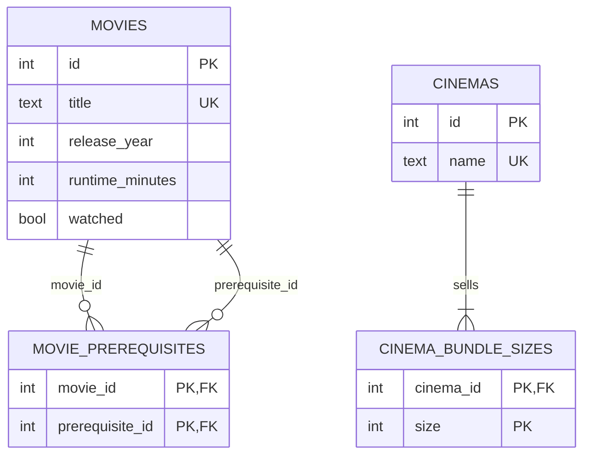

# Doomsday Ready

A minimal full-stack MCU rewatch planner and opening-night watch-party booking quote app.

## Tech stack

- React 18 + Vite + TypeScript
- Node.js 20 + Express + TypeScript
- PostgreSQL 16 and Drizzle ORM
- Vitest
- Docker Compose

The Feature 1 graph algorithms and Feature 2 booking algorithm are hand-written in plain TypeScript. No graph, toposort, knapsack, or coin-change solving library is used.

## Docker Compose

Docker Desktop must be running:

```bash
docker compose up --build
```

Open http://localhost:8080. The database uses a named volume. Stop it with `docker compose down`; reset it with `docker compose down -v`.

## Host development

```bash
docker compose up -d db
npm install
npm --prefix server install
npm --prefix client install
npm run db:generate
npm run migrate
npm run seed
npm run dev
```

The host database is published on port `55432` because port `5432` may be used by a local PostgreSQL instance.

## Commands

- `npm run dev` - start API and client
- `npm run build` - build both packages
- `npm test` - run server tests
- `npm run migrate` - apply migrations
- `npm run seed` - load sample data

## API

Base path: `/api`

| Method | Path | Purpose |
|---|---|---|
| GET | `/health` | Check API availability (`/api/health` with the full base path) |
| POST | `/movies` | Create a movie |
| GET | `/movies` | List movies |
| GET | `/movies/:id` | Get one movie |
| PATCH | `/movies/:id` | Update a movie |
| DELETE | `/movies/:id` | Delete a movie |
| GET | `/movies/:id/rewatch-order` | Get prerequisites and stats |
| POST | `/cinemas` | Create a cinema |
| GET | `/cinemas` | List cinemas |
| GET | `/cinemas/:id` | Get a cinema |
| DELETE | `/cinemas/:id` | Delete a cinema and its bundle sizes |
| GET | `/cinemas/:id/booking?groupSize=N` | Get a booking quote |

Errors use `{ "error": { "code": "VALIDATION_ERROR", "message": "..." } }`.

Codes: `VALIDATION_ERROR`, `NOT_FOUND`, `DUPLICATE_TITLE`, `DUPLICATE_NAME`, `CIRCULAR_DEPENDENCY`, `INTERNAL_ERROR`.

## Data model



## Algorithms

- Cycle detection uses an iterative prerequisite walk and runs in O(V + E).
- Rewatch order uses iterative depth-first post-order traversal and runs in O(V + E).
- Booking quotes use bottom-up dynamic programming with reconstruction and run in O(groupSize × bundleCount).

## Assumptions

- Titles and cinema names are unique case-insensitively.
- PATCH replaces the whole prerequisite set.
- "Not possible" is a `200` response with `possible: false`.
- Release years range from 1900 through 2100.
- If several minimum bundle combinations exist, one is returned.
- Sample prerequisite links are sample data, not an official watch guide.
- Missing prerequisite IDs are rejected with `400`.

## Deploying with Vercel and Render

1. Create a PostgreSQL database on Render or another managed PostgreSQL provider.
2. Push this repository to GitHub.
3. In Render, create a Web Service from the `server` directory.
   - Root Directory: `server`
   - Runtime: Docker
   - Dockerfile Path: `Dockerfile`
   - Set `DATABASE_URL` to the provider connection string.
   - Set `DATABASE_SSL=true`, `NODE_ENV=production`, `PORT=3000`, `SEED_ON_START=true`.
   - Set `CORS_ORIGIN` to the Vercel frontend URL.
4. Deploy the backend and verify `/api/health`.
5. In Vercel, import the GitHub repository.
   - Framework preset: Vite
   - Root directory: `client`
   - Build command: `npm run build`
   - Output directory: `dist`
   - Set `VITE_API_BASE_URL` to the Render service URL, for example `https://doomsday-api.onrender.com/api`.
6. Redeploy the frontend after setting the environment variable.
7. Update `CORS_ORIGIN` in Render to the exact Vercel URL and redeploy the backend if the URL changed.

`VITE_API_BASE_URL` may be set to either the Render origin (`https://doomsday-ready-app.onrender.com`)
or the origin with `/api` (`https://doomsday-ready-app.onrender.com/api`). The frontend normalizes both forms.

Never commit a real `.env`; keep secrets in Render and Vercel environment settings.
